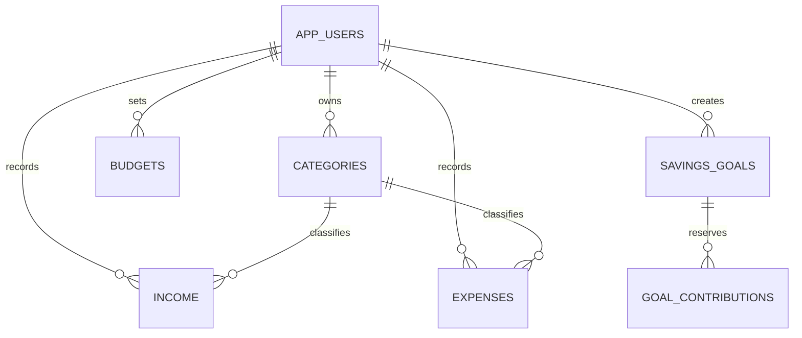

# Database schema

The authoritative migration is:
`backend/src/main/resources/db/migration/V1__initial_schema.sql`

`schema-reference.sql` is an identical copy for faculty review. **Do not execute this copy against a database that Flyway manages.** Spring Boot applies the migration automatically once and stores its checksum in `flyway_schema_history`.

Create/provision an empty MySQL database, give the application access, then start it. Do not edit V1 after a real database has applied it: create V2 for future changes instead. Do not delete the MySQL volume to fix a migration error, because that deletes financial records.

| Object | Purpose |
|---|---|
| app_users | Account name, unique normalized email and password hash |
| categories | Owned INCOME or EXPENSE labels |
| income | Income amounts, dates, category and description |
| expenses | Expense amounts, dates, category and description |
| budgets | One user/month limit |
| savings_goals | Target amount and deadline |
| goal_contributions | Reservations allocated to goals |
| financial_transactions | Read-only UNION ALL view of income and expenses |

Income and expense tables have independent numeric IDs. A transaction's identity is therefore **(type, id)**, not just id. Frontend keys and API routes include both. All owned queries include `user_id`.

Money columns use DECIMAL, positive checks and NOT NULL. Foreign keys enforce ownership/type relationships. Names are unique within user and category type; budgets are unique per user and month. User/date indexes support history and monthly summaries. Categories referenced by transactions cannot be deleted. Deleting a goal cascades only its contributions.

## Relationship diagram (Mermaid source)

The diagram is supplied as editable text, not a rendered image. It omits Flyway's internal history table.
